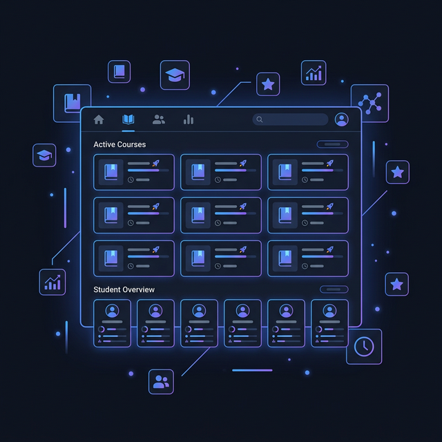

<div align="center">

# 🎓 AttendEase
### Attendance Management System

**A full-stack web application for managing student attendance, quizzes, and grades — built for university instructors.**

[](https://python.org)
[](https://flask.palletsprojects.com)
[](https://sqlite.org)
[](LICENSE)

</div>

---

## 📋 Table of Contents

- [Overview](#-overview)
- [Key Features](#-key-features)
- [Screenshots](#-screenshots)
- [Technologies Used](#-technologies-used)
- [Prerequisites](#-prerequisites)
- [Installation & Setup](#-installation--setup)
- [Environment Variables](#-environment-variables)
- [Running the Application](#-running-the-application)
- [Project Structure](#-project-structure)
- [Default Credentials](#-default-credentials)
- [Future Improvements](#-future-improvements)
- [Author](#-author)

---

## 🌐 Overview

**AttendEase** is a modern, web-based attendance management system designed for university teaching assistants and instructors. It provides a clean single-page interface to track attendance across lectures, sections, and labs; manage quizzes and grades; generate reports in multiple formats; and administer user accounts — all from one dashboard.

The backend is a RESTful Flask API backed by SQLite. The frontend is a rich, responsive single-page application built with vanilla HTML, CSS, and JavaScript, supporting both **light and dark themes** and **Arabic/English bilingual UI**.

---

## ✅ Key Features

### 👤 Authentication & User Management
- Secure registration with **email OTP verification** (6-digit code, 15-minute expiry)
- **Admin approval workflow** — new accounts are activated only after admin review
- **Password reset via email link** (token valid for 1 hour)
- Strong password enforcement (min 8 chars, uppercase, lowercase, number, special character)
- Admin can **block / unblock / delete** instructor accounts
- User profile management (name, email, password, UI mode)

### 📚 Course Management
- Create, edit, and delete courses with a unique course code per instructor
- Per-course configurable **absence warning thresholds** (Warning 1, Warning 2, Deprivation) for both lectures and sections/labs
- Configurable **absence weights** (lecture vs. section/lab) for combined scoring
- Optional **attendance grade** system: set a maximum grade and deduction per absence

### 📅 Attendance Sessions
- Create sessions of type **Lecture**, **Section**, or **Lab**
- Paired side-by-side view: lecture sessions on the left, section/lab sessions on the right
- Mark individual sessions as **cancelled** (excluded from all absence calculations)
- **Quick Attendance** input: type a Student ID and press Enter to instantly toggle presence
- **Bulk mark all present / all absent** with one click
- **AI-powered attendance sheet import** — upload a scanned or photographed attendance sheet and let the Gemini AI extract the data automatically

### 👨‍🎓 Student Management
- Add students individually or **bulk-import from Excel** (.xlsx) using the provided template
- Enroll students in courses; automatic deduplication
- Real-time absence counters and warning level badges per student
- **Random group division** — split enrolled students into N groups and export as Excel, Word, or PDF

### 📊 Reports & Export
- Export full attendance report per course as a **formatted Excel workbook** (styled with colour coding)
- Export per-session attendance roster as Excel
- Generate **official absence warning letters** (1st Warning) as a Word document using a DOCX template
- Export student group divisions to Excel, Word, and PDF

### 📝 Quiz & Grade Management
- Create quizzes per course with name, date, max score, and notes
- Optional: link a quiz to an attendance session (quiz used as attendance)
- Record individual student scores; track whether a score has been officially graded
- Upload quiz question files and model answer files

### 🤖 AI Chatbot
- Integrated Gemini-powered assistant accessible from the application
- Helps instructors with queries about attendance data and system usage

### 🎨 UI / UX
- **Light / Dark mode** toggle (persisted in localStorage)
- **Arabic / English** bilingual interface with RTL support
- **Standard / Simple UI mode** switchable per user account
- Responsive sidebar layout with breadcrumb navigation
- Real-time feedback on all form interactions

---

## 🖼️ Screenshots

| Courses Dashboard | Session Management |
|:-:|:-:|
|  |  |

| Reports & Exports | Quiz & Grades |
|:-:|:-:|
|  |  |

---

## 🛠️ Technologies Used

### Backend
| Package | Version | Purpose |
|---|---|---|
| Flask | 3.0.3 | Web framework |
| Flask-SQLAlchemy | 3.1.1 | ORM / database layer |
| Flask-Login | 0.6.3 | Session-based authentication |
| Flask-Bcrypt | 1.0.1 | Password hashing |
| Flask-Cors | 4.0.1 | Cross-Origin Resource Sharing |
| SQLAlchemy | 2.0.44 | SQL toolkit |
| openpyxl | 3.1.3 | Excel read/write |
| google-generativeai | 0.8.6 | Gemini AI integration |
| python-dotenv | 1.1.1 | `.env` file loading |
| python-docx | 1.1.0 | Word document generation |
| fpdf2 | 2.8.7 | PDF generation |
| Werkzeug | 3.1.3 | WSGI utilities |

### Frontend
- **Vanilla HTML5, CSS3, JavaScript** (single-page application — no framework)
- **Google Fonts** — Inter, Outfit, Noto Sans Arabic
- Custom CSS design system with CSS variables for light/dark theming

### Database
- **SQLite** — file-based relational database (`attendance.db`), auto-created on first run

---

## 📦 Prerequisites

- **Python 3.10 or higher**
- **pip** (Python package installer)
- A Gmail account with **2-Step Verification** enabled (for email features)
- A **Google Gemini API key** (for the AI features — free tier available at [aistudio.google.com](https://aistudio.google.com))

---

## ⚙️ Installation & Setup

### 1. Clone the Repository

```bash
git clone https://github.com/PaulaSamy5/AttendEase.git
cd AttendEase
```

### 2. Create and Activate a Virtual Environment

```bash
# Windows
python -m venv venv
venv\Scripts\activate

# macOS / Linux
python3 -m venv venv
source venv/bin/activate
```

### 3. Install Dependencies

```bash
pip install -r requirements.txt
```

### 4. Configure Environment Variables

Copy the example environment file and fill in your credentials:

```bash
cp .env.example .env
```

Then open `.env` and replace the placeholder values (see [Environment Variables](#-environment-variables) below).

---

## 🔐 Environment Variables

The application reads configuration from a `.env` file in the project root. **Never commit your real `.env` to version control.**

| Variable | Description | Example |
|---|---|---|
| `MAIL_SERVER` | SMTP server address | `smtp.gmail.com` |
| `MAIL_PORT` | SMTP port (TLS) | `587` |
| `MAIL_USERNAME` | Gmail address used to send emails | `you@gmail.com` |
| `MAIL_PASSWORD` | Gmail **App Password** (16 chars, no spaces) | `abcd efgh ijkl mnop` |
| `GEMINI_API_KEY` | Google Gemini API key | `AIzaSy...` |

> **How to get a Gmail App Password:**
> 1. Go to [myaccount.google.com/security](https://myaccount.google.com/security)
> 2. Enable **2-Step Verification**
> 3. Visit [myaccount.google.com/apppasswords](https://myaccount.google.com/apppasswords)
> 4. Create an App Password for **Mail → Windows Computer**
> 5. Copy the 16-character password (remove the spaces)

> **Note:** Email and AI features are optional. The application runs without them — email sending will be silently skipped if credentials are missing.

---

## 🚀 Running the Application

```bash
python run.py
```

The server starts on **http://localhost:5000** in debug mode.

On the **first run**, the application will:
1. Automatically create the `attendance.db` SQLite database
2. Run any pending schema migrations
3. Create a default **admin account** (if no users exist)

Open your browser and navigate to: **http://localhost:5000**

---

## 🗂️ Project Structure

```
AttendEase/
├── app/
│   ├── __init__.py        # Flask application factory, DB init, auto-migration
│   ├── models.py          # SQLAlchemy models (User, Course, Student, Enrollment,
│   │                      #   AttendanceSession, AttendanceRecord, Quiz, Grade)
│   └── routes.py          # All API endpoints and page serving (~2900 lines)
│
├── frontend/
│   ├── index.html         # Single-page application shell
│   ├── style.css          # Full design system (light/dark theme, components)
│   ├── app.js             # All frontend logic (API calls, UI rendering, state)
│   └── img_doc_*.png      # Documentation screenshots
│
├── uploads/               # User-uploaded files (quiz sheets, attendance images)
│
├── run.py                 # Application entry point
├── requirements.txt       # Python dependencies
├── .env.example           # Environment variable template (safe to commit)
├── .env                   # Your local credentials — DO NOT commit
└── README.md
```

---

## 🔑 Default Credentials

When the database is created for the first time with no existing users, a default admin account is created automatically:

| Field | Value |
|---|---|
| Username | `admin` |
| Password | `123456` |

> ⚠️ **Change the default password immediately** after your first login via the Profile settings.

---

## 🔮 Future Improvements

The following features are **not yet implemented** and are planned for future versions:

- 📱 **Mobile responsive design** — full optimization for smartphones and tablets
- 📈 **Analytics dashboard** — charts and trend graphs for attendance rates over time
- 🔔 **Push/SMS notifications** — alert students directly when they reach warning thresholds
- 📤 **Email reports to students** — automatically send absence summaries to student email addresses
- 🌍 **Multi-language support** — extend the i18n system beyond Arabic/English
- 🔗 **LMS integration** — connect with platforms like Moodle or Google Classroom
- 🐳 **Docker deployment** — containerized setup for easy production deployment
- 🔒 **Role-based access control** — teaching assistant role with limited permissions
- ☁️ **Cloud database support** — PostgreSQL/MySQL backend for multi-user deployments

---

## 👩‍💻 Author

**Paula Samy**

- GitHub: [@PaulaSamy5](https://github.com/PaulaSamy5)

---

<div align="center">
  Made with ❤️ for better classroom management
</div>
